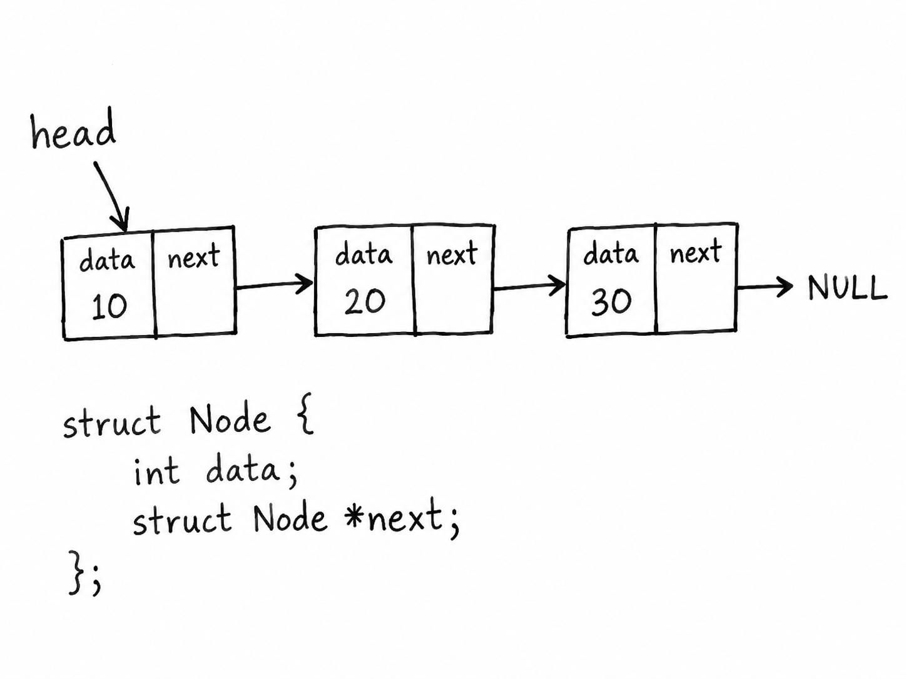

Replace this example text with your own report.

Explain the structure of your allocator, its allocation strategy, metadata, and integrity mechanisms. Refer to relevant parts of your implementation.

A design figure can be included and referenced as shown below. The image should be your own hand-drawn design diagram.


{@fig:allocator-design|Example allocator design showing the main memory regions}

As shown in [@fig:allocator-design], a figure can be referred to directly in the text.

To cite a technical source, use a named citation key such as:

```text
[^example2008]
```

Replace the example citation with citations to sources that you actually use.
